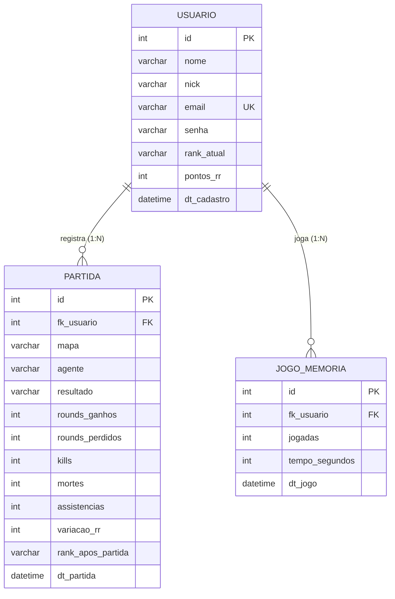

# 🎯 VALORA — Tracker de Desempenho & Jogo da Memória (VALORANT)

O **Valora** é uma aplicação web Full Stack desenvolvida como **Projeto Individual** acadêmico, inspirada no universo competitivo de **VALORANT**. A plataforma foi idealizada para ajudar jogadores a registrarem suas partidas, acompanharem sua evolução de elo (**Rank e Pontos RR**) por meio de uma **Dashboard Analítica** e exercitarem o foco e a memória visual através de um **Jogo da Memória dos Agentes**.

---

## 📌 Índice

1. [Sobre o Projeto](#-sobre-o-projeto)
2. [Objetivos da Solução](#-objetivos-da-solução)
3. [O Que a Solução Faz (Escopo Funcional)](#-o-que-a-solução-faz-escopo-funcional)
4. [Regras de Negócio, KPIs e Gráficos](#-regras-de-negócio-kpis-e-gráficos)
5. [Arquitetura e Modelagem do Banco de Dados](#-arquitetura-e-modelagem-do-banco-de-dados)
6. [Tecnologias Utilizadas](#-tecnologias-utilizadas)
7. [Estrutura de Diretórios](#-estrutura-de-diretórios)
8. [Como Executar o Projeto](#-como-executar-o-projeto)

---

## 📖 Sobre o Projeto

Muitos jogadores de **VALORANT** desejam entender melhor o próprio desempenho competitivo, mas acabam dependendo de memória ou de planilhas manuais complexas para acompanhar suas estatísticas.

O **Valora** resolve esse problema centralizando o histórico de partidas do jogador em um só lugar:
- Ao registrar uma partida, o usuário informa **Mapa**, **Agente**, **Resultado**, **Placar de Rounds**, **Kills**, **Mortes**, **Assistências** e os **Pontos (RR)** ganhos ou perdidos.
- O sistema processa automaticamente esses dados para calcular **K/D**, **Win Rate (%)**, **Agente Favorito**, **Melhor e Pior Mapa**, além de atualizar automaticamente a **subida ou descida de Rank a cada 100 RR**.
- Entre uma partida e outra, o jogador pode acessar o **Jogo da Memória dos Agentes**, desafiando-se a encontrar todos os pares com o menor número possível de jogadas e acompanhando sua evolução na Dashboard.

---

## 🎯 Objetivos da Solução

O projeto foi concebido integrando três dimensões fundamentais:

### 1. Visão de Produto e Evolução do Jogador
Transformar dados brutos de partidas em **inteligência prática para tomada de decisão**. Em vez de apenas jogar no automático, o jogador visualiza métricas claras sobre quais mapas e agentes trazem melhores resultados e como está sua consistência de K/D e progressão de Rank.

### 2. Conexão Pessoal, Valores e ODS 3 (ONU)
- **História Pessoal & Valores**: Reflete a vivência com o VALORANT como ferramenta de desenvolvimento de **foco, pensamento estratégico, disciplina e resiliência** — aprendendo com os erros de cada partida para evoluir continuamente, tanto no jogo quanto na jornada acadêmica em tecnologia.
- **ODS 3 — Saúde e Bem-Estar**: Alinhado ao Objetivo de Desenvolvimento Sustentável 3 da ONU, o projeto promove o equilíbrio entre lazer digital saudável, autoconhecimento e **estímulo cognitivo** (atenção, concentração e memória visual exercitadas pelo Jogo da Memória dos Agentes).

### 3. Objetivo Acadêmico e Técnico (Full Stack)
Consolidar na prática os conhecimentos de desenvolvimento web utilizando a arquitetura `web-data-viz`:
- Construção de API REST com **Node.js** e **Express** (padrão MVC: `routes`, `controllers`, `models`).
- Persistência e consultas relacionais em banco de dados **MySQL** (agregações matemáticas `SUM`, `AVG`, `MIN`, `COUNT` e `GROUP BY`).
- Interface responsiva em **HTML5**, **CSS3** e **JavaScript**, integrada à biblioteca **Chart.js** para visualização de dados.

---

## 🖥️ O Que a Solução Faz (Escopo Funcional)

A aplicação é composta por **6 páginas oficiais**, divididas entre a área pública (implementada em `valora/public/`) e a área autenticada:

### Área Pública (`valora/public/`)
1. **Landing Page (`index.html`)**: Apresenta a proposta do Valora, resumo das funcionalidades (Cadastro de Partidas, Dashboard Pessoal, Rank/Pontos e Jogo da Memória) e chamadas para ação (Criar Conta / Entrar).
2. **Cadastro de Usuário (`cadastro.html`)**: Permite criar uma conta informando:
   - `Nome`
   - `Nick no jogo` (ex: `Jett_BR#1234`)
   - `E-mail` e `Senha` (com confirmação)
   - `Rank atual` (seleção entre os 25 elos oficiais, de `Ferro 1` a `Radiante`)
   - `Pontos (RR)` iniciais no rank atual
3. **Login (`login.html`)**: Autenticação do jogador via `E-mail` e `Senha` para acesso à área logada e carregamento da sessão.

### Área Autenticada (Fluxo do Jogador Logado)
4. **Dashboard Pessoal (`dashboard.html`)**: Painel central do jogador exibindo os **6 KPIs principais**, **Gráficos interativos** de evolução nas partidas e no Jogo da Memória, além da **tabela de histórico de partidas**.
5. **Registro de Partidas (`partidas.html`)**: Formulário para cadastrar novas partidas competitivas (`Mapa`, `Agente`, `Resultado`, `Rounds Ganhos/Perdidos`, `Kills`, `Mortes`, `Assistências` e `Variação de RR`), disparando o cálculo automático de atualização de Rank/RR do usuário.
6. **Jogo da Memória dos Agentes (`memoria.html`)**: Minigame interativo com cartas dos agentes de VALORANT. Contabiliza o número de jogadas/tentativas e o tempo até encontrar todos os pares, registrando a pontuação no banco de dados.

---

## 📊 Regras de Negócio, KPIs e Gráficos

### Progressão Automática de Rank e Pontos (Regra dos 100 RR)
O sistema gerencia a progressão competitiva percorrendo a hierarquia oficial de 25 tiers do VALORANT (`Ferro 1..3` → `Bronze 1..3` → `Prata 1..3` → `Ouro 1..3` → `Platina 1..3` → `Diamante 1..3` → `Ascendente 1..3` → `Imortal 1..3` → `Radiante`):
- **Subida de Rank (Promoção)**: Sempre que o saldo de `pontos_rr` atingir ou ultrapassar **`100 RR`** após uma partida, o jogador sobe automaticamente para o próximo elo e mantém o saldo excedente (`novo_rr = pontos_rr - 100`).
- **Descida de Rank (Rebaixamento)**: Se uma derrota fizer o saldo de `pontos_rr` ficar menor que **`0 RR`**, o jogador desce para o elo imediatamente anterior com o saldo descontado (respeitando o piso mínimo de `Ferro 1` com `0 RR`).

### Indicadores da Dashboard (6 KPIs)
| KPI | Descrição / Cálculo |
| :--- | :--- |
| **1. Rank & RR Atual** | Exibe o elo atual do jogador e sua pontuação (`pontos_rr / 100 RR`). |
| **2. K/D Geral** | Razão entre o total de abates e o total de mortes: $\text{K/D} = \frac{\sum \text{Kills}}{\sum \text{Mortes}}$. |
| **3. Win Rate (%)** | Taxa percentual de vitórias: $\text{Win Rate} = \left(\frac{\text{Total de Vitórias}}{\text{Total de Partidas}}\right) \times 100$. |
| **4. Agente Favorito** | O agente com a maior quantidade de partidas registradas pelo jogador. |
| **5. Melhor e Pior Mapa** | Os mapas com a maior e a menor taxa de vitórias (Win Rate) do usuário. |
| **6. Recorde no Jogo da Memória** | O menor número de jogadas (`MIN(jogadas)`) que o usuário levou para concluir o tabuleiro. |

### Gráficos (Chart.js) e Histórico
1. **Evolução nas Partidas (Gráfico de Linha)**: Mostra a variação do K/D e/ou saldo de RR ao longo das últimas partidas cadastradas.
2. **Desempenho por Mapa / Agente (Gráfico de Barras ou Rosca)**: Compara a distribuição de vitórias e derrotas por mapa ou agente utilizado.
3. **Evolução no Jogo da Memória (Gráfico de Linha/Barras)**: Apresenta a curva de aprendizado e foco do jogador (quantidade de jogadas por tentativa ao longo do tempo).
4. **Histórico de Partidas**: Lista detalhada com as partidas registradas (Data, Mapa, Agente, Placar de Rounds, K/D/A, Resultado e RR).

---

## 🗄️ Arquitetura e Modelagem do Banco de Dados

O banco de dados MySQL chama-se **`valora`** e utiliza um modelo relacional direto com **3 tabelas principais** (`1:N` a partir de `usuario`), definido em [`valora/src/database/script-tabelas.sql`](valora/src/database/script-tabelas.sql):



### Rotas da API Express (Arquitetura MVC)
- **`/usuarios`**:
  - `POST /usuarios/cadastrar` — Cadastra novo jogador com seu Rank e RR iniciais.
  - `POST /usuarios/autenticar` — Realiza login e retorna os dados do perfil e Rank atual.
- **`/partidas`**:
  - `POST /partidas/registrar` — Insere nova partida e atualiza automaticamente o `rank_atual` e `pontos_rr` do usuário.
  - `GET /partidas/listar/:idUsuario` — Retorna o histórico de partidas do jogador.
  - `GET /partidas/kpis/:idUsuario` — Retorna os KPIs consolidados (K/D, Win Rate, Agente Favorito, Melhor/Pior Mapa) e dados para os gráficos.
- **`/memoria`**:
  - `POST /memoria/registrar` — Salva o resultado (número de jogadas e tempo) de uma rodada do Jogo da Memória.
  - `GET /memoria/estatisticas/:idUsuario` — Retorna o recorde (`MIN(jogadas)`) e o histórico de tentativas para o gráfico da Dashboard.

---

## 🛠️ Tecnologias Utilizadas

- **Front-end**:
  - `HTML5` & `CSS3` (Estilização temática inspirada na identidade visual do VALORANT: `#0c1117`, `#131b24`, `#ff4655`)
  - `JavaScript (ES6+)` (Fetch API, manipulação de DOM, lógica do Jogo da Memória e cálculo de Rank/RR)
  - `Chart.js` (Renderização dos gráficos dinâmicos na Dashboard)
- **Back-end**:
  - `Node.js`
  - `Express` (Servidor web e roteamento da API REST)
  - `mysql2` (Driver de conexão com o banco de dados MySQL)
  - `dotenv` & `cors` (Gerenciamento de variáveis de ambiente e controle de acesso)
- **Banco de Dados**:
  - `MySQL 8.0+`

---

## 📂 Estrutura de Diretórios

```text
Projeto-Individual/
├── README.md
└── valora/
    ├── app.js                         # Ponto de entrada do servidor Node/Express
    ├── package.json                   # Dependências e scripts npm
    ├── public/                        # Diretório estático servido pelo Express
    │   ├── index.html                 # Landing Page oficial do Valora
    │   ├── login.html                 # Página de Login
    │   ├── cadastro.html              # Página de Cadastro (com Rank e Pontos RR)
    │   ├── css/
    │   │   └── inicial.css            # Folha de estilos das páginas iniciais
    │   ├── js/                        # Scripts de front-end
    │   └── assets/
    │       └── imgs/                  # Imagens de fundo e assets visuais do Valora
    │           ├── cadastro.jpg
    │           ├── fundo.png
    │           ├── imagens.jpeg
    │           └── login.jpg
    └── src/
        ├── controllers/               # Lógica de controle das requisições da API
        │   └── usuarioController.js
        ├── database/
        │   ├── config.js              # Configuração de conexão com o MySQL
        │   └── script-tabelas.sql     # Script DDL de criação do banco 'valora' e suas 3 tabelas
        ├── models/                    # Consultas SQL executadas no MySQL
        │   └── usuarioModel.js
        └── routes/                    # Definição dos endpoints da API Express
            ├── index.js
            └── usuarios.js
```

---

## 🚀 Como Executar o Projeto

### Pré-requisitos
- **Node.js** (v18 ou superior)
- **MySQL Server** / **MySQL Workbench** (v8.0 ou superior)

### Passo a Passo

1. **Clone o repositório:**
   ```bash
   git clone <URL_DO_REPOSITORIO>
   cd Projeto-Individual/valora
   ```

2. **Configure o Banco de Dados MySQL:**
   - Abra o seu MySQL Workbench ou terminal MySQL.
   - Execute o script localizado em [`src/database/script-tabelas.sql`](valora/src/database/script-tabelas.sql) para criar o banco `valora` e as tabelas `usuario`, `partida` e `jogo_memoria`.

3. **Configure as Variáveis de Ambiente (`.env.dev`):**
   - Verifique/crie o arquivo `.env.dev` na pasta `valora/` com as credenciais do seu MySQL local:
     ```env
     AMBIENTE_PROCESSO=desenvolvimento
     APP_HOST=localhost
     APP_PORT=3333
     DB_HOST=localhost
     DB_DATABASE=valora
     DB_USER=root
     DB_PASSWORD=sua_senha_aqui
     DB_PORT=3306
     ```

4. **Instale as dependências e inicie o servidor:**
   ```bash
   npm install
   npm start
   ```

5. **Acesse no navegador:**
   - Abra `http://localhost:3333` para visualizar a aplicação.
